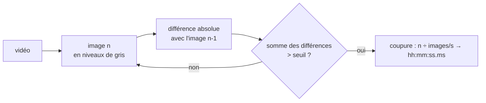

<div align="center">

# ✂️ Auto cut video

**Repère automatiquement chaque changement de plan d'une compilation vidéo et donne ses time codes.**


</div>

---

## ✨ Ce que fait le script

Une compilation, c'est une suite de clips collés bout à bout. Le script lit la vidéo image par image et détecte **les coupures** (changements brusques d'image), puis affiche (exemple) :

```
Time codes des coupures détectées :
00:00:12.480
00:00:27.040
00:01:03.320
Nombre total de coupures détectées : 3
```

Ces time codes servent ensuite à découper la vidéo en clips (avec un logiciel de montage ou `ffmpeg`).

---

## 🚀 Utilisation

```bash
pip install opencv-python
python3 detect_coupures.py
Entrez le chemin vers la vidéo : compilation.mp4
```

Pour l'utiliser depuis un autre script :
```python
from detect_coupures import detecter_coupures
timecodes, nombre = detecter_coupures("compilation.mp4", seuil=8_000_000)
```

---

## ⚙️ Comment ça marche



Le **seuil** (8 000 000 par défaut) dépend de la résolution : plus la vidéo est grande, plus la somme des différences est élevée. Baisse-le si des coupures sont manquées, monte-le s'il y a de fausses détections.

---

## 🗂️ Organisation des fichiers

```
auto-cut-video/
└── detect_coupures.py   détection des changements de plan (fonction + utilisation en ligne de commande)
```

---

## 💻 Compatibilité

| | |
|---|---|
| **Systèmes** | Windows, macOS, Linux |
| **Python** | 3.8+ avec `opencv-python` |
| **Formats** | tout ce que lit OpenCV / FFmpeg (MP4, MKV, AVI…) |

### 🧭 Pistes
- [ ] Découpe automatique en fichiers avec `ffmpeg`.
- [ ] Seuil relatif à la résolution (pourcentage de pixels changés).
- [ ] Ignorer les fondus et les flashs.

---

<div align="center"><sub>Python · OpenCV · traitement vidéo</sub></div>
